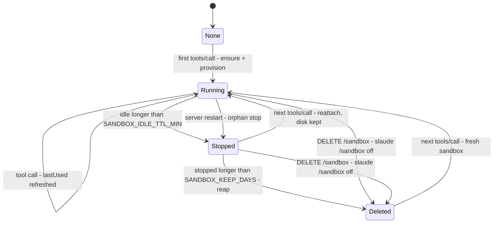
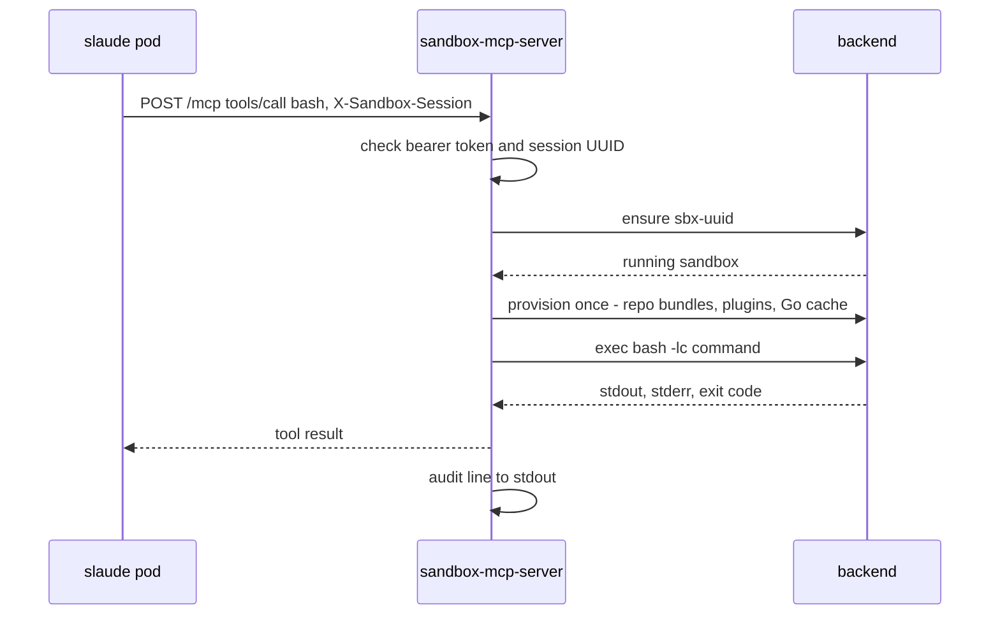

# Sandbox lifecycle and usage

Covers the server as of the `DELETE /sandbox` change, and the slaude fork branch `factory/sandbox-mcp` with per-thread sandbox mode. Section 5 lists what is still not built.

## 1. What a sandbox is

A sandbox belongs to one `X-Sandbox-Session` value, a lowercase UUID (`src/backend.ts:93`). slaude sends its session row id there, so a sandbox maps to one Slack thread and persona. Any other value is refused with 400 before a backend sees it.

| Backend | One sandbox is | Disk |
|---|---|---|
| `docker`, `vps` | container `sbx-<uuid>`, uid 1000, `--cap-drop ALL`, `no-new-privileges`, `--pids-limit 512` (`src/backend-docker.ts:37-44`) | volumes `sbx-<uuid>-ws` (the workspace) and `sbx-<uuid>-data` |
| `k8s` | Pod plus PVC `sbx-<uuid>` (`src/backend-k8s.ts`) | the PVC |
| `local` | directory `$TMPDIR/sandbox-mcp/sbx-<uuid>` (`src/backend-local.ts`), tests and development only, no isolation | the directory |
| `vercel` | a Vercel Sandbox (`src/backend-vercel.ts`), unverified | Vercel snapshot |

The sandbox holds no credential and no git remote. Go runs with `GOPROXY=off` against a module cache that the server fills.

## 2. Lifecycle



| Transition | Trigger | What happens | Code |
|---|---|---|---|
| None to Running | The first `tools/call` for a session. `initialize` and `tools/list` never create a sandbox | `backend.ensure(key)` creates the sandbox, then provisions it once (below). Parallel first calls share one `ensure`. A failure returns 503 and is retried on the next call | `src/main.ts:66-81`, `src/sessions.ts:31-40` |
| Running to Running | Any tool call | `lastUsed` is set to now | `src/sessions.ts:39` |
| Running to Stopped (idle) | The sweep, every `SANDBOX_SWEEP_SEC` (default 60), finds no call for `SANDBOX_IDLE_TTL_MIN` (default 60) | `backend.stop(key)`: compute is freed, the disk is kept. Background jobs die with it, because only tool calls move `lastUsed` | `src/sessions.ts:43-51` |
| Running to Stopped (restart) | The server process starts | Every sandbox this process has not served is stopped. The next call reattaches | `src/sessions.ts:67-72` |
| Stopped to Running | The next tool call | `ensure` restarts the container or pod with the disk intact. The `.provisioned` marker skips seeding | `src/backend-docker.ts:32-53`, `src/provision.ts:8` |
| Stopped to Deleted | The same sweep calls `backend.reap(SANDBOX_KEEP_DAYS)` (default 7) | Docker: exited containers whose `FinishedAt` is older than the window are removed with both volumes. k8s: PVCs with no running pod and a `sandbox/last-used` annotation older than the window are deleted | `src/sessions.ts:52-55`, `src/backend-docker.ts:56-74`, `src/backend-k8s.ts:99-122` |
| Running or Stopped to Deleted (on demand) | `DELETE /sandbox` with the bearer token and `X-Sandbox-Session`. slaude sends it on `/sandbox off`, and when `/remote on` replaces sandbox mode | `sessions.destroy(key)`: the session leaves the cache and `backend.destroy(key)` removes the container or pod and its disk. Returns 204, also when there was nothing to delete. A bad key returns 400, a backend failure 502 | `src/main.ts`, `src/sessions.ts` |
| Deleted to Running | A tool call for a deleted session | A fresh sandbox, provisioned from scratch. Earlier files and unpushed commits are gone | `src/main.ts:66-81` |

Provisioning runs once per sandbox (`src/provision.ts:110-139`):
1. Each repo in `SANDBOX_REPOS` is cloned from the server-side bare mirror as a `git bundle --all`. The `origin` remote is removed, and `user.name`/`user.email` are set from `SANDBOX_GIT_USER`/`SANDBOX_GIT_EMAIL`. Mirrors refresh every `SANDBOX_MIRROR_REFRESH_MIN` (default 10) with the clone key, and the first provision waits for the first refresh.
2. The plugin tree is unpacked to `/data/.claude/plugins`, from `SANDBOX_PLUGIN_DIR` or, on k8s, from a pod matching `SANDBOX_PLUGIN_SOURCE_SELECTOR`.
3. The Go module cache is mounted read-only from `SANDBOX_GOMOD_VOLUME` (docker), or copied in. The server runs `go mod download` whenever a `go.sum` changes.

State kept in the server process, per session: the shell cwd, file read times used by `edit` and `write`, and background job output offsets (`src/sessions.ts:16-21`). A server restart loses it. The cwd resets to `SANDBOX_ROOT`, and `bash_output` returns a job's log from the start.

Known limits:
- Docker and vps sandboxes have no memory or CPU cap, and use the default bridge network with open egress (`src/backend-docker.ts:37-44`). One heavy `go test` can starve every other sandbox on the host.
- On k8s, the restart stop re-annotates `last-used` on every PVC (`src/backend-k8s.ts:96`). Each server restart pushes back the 7-day delete.
- `local` never reaps. `vercel` leaves deletion to Vercel snapshot expiry (`src/backend-vercel.ts:81`).
- A failed provision leaves its container until the next server start stops it.

## 3. How to use it

### Run

Local, no isolation:

```sh
bun install
SLAUDE_SANDBOX_MCP_TOKEN=secret SANDBOX_BACKEND=local bun run src/main.ts
```

Docker on one host, which is the layout running for Samson on `factory-sandbox-vps`: the server runs on the VM next to the Docker socket with `SANDBOX_BACKEND=docker`, behind Caddy at `https://sandbox.fqdr.dev/mcp`. `SANDBOX_GOMOD_VOLUME` shares one read-only Go cache, so each sandbox does not copy several gigabytes.

### Connect slaude

Set these on the slaude deployment (the fork branch `factory/sandbox-mcp`):

| Variable | Value |
|---|---|
| `SLAUDE_SANDBOX_MCP_URL` | `https://<host>/mcp` |
| `SLAUDE_SANDBOX_MCP_TOKEN` | the same value as this server's `SLAUDE_SANDBOX_MCP_TOKEN` |
| `SLAUDE_LOCAL_EXEC` | `on` for threads that are not in a sandbox to run Bash in the slaude pod; `off` gives them no shell at all |
| `SLAUDE_SANDBOX_AUTO_USERS` | Slack user ids whose turns may let the agent switch a thread on with `enter_sandbox` (comma-separated, `*` = everyone, empty = nobody) |

slaude mounts this server under the name `remote` and aliases `Bash`, `Read`, `Write`, `Edit`, `Glob` and `Grep` to its tools. Every request carries `Authorization: Bearer <token>` and `X-Sandbox-Session: <session uuid>`.

A thread uses the sandbox only after it is switched on. Every other thread runs in the slaude pod as if no sandbox existed.

| How | Who | Effect |
|---|---|---|
| `/sandbox on` | Anyone in the thread. In a `/remote` thread, only its owner or the manager, because it ends remote mode | From the next message, the six tools run in the thread's sandbox. The first call creates it, in about 20 s |
| `enter_sandbox` (a tool the agent calls before code work) | Only when the Slack user who started the turn is in `SLAUDE_SANDBOX_AUTO_USERS`. Never in a `/remote` thread | Same as `/sandbox on`. Otherwise the agent asks the user to type `/sandbox on` |
| `/sandbox off` | Anyone in the thread | Mode off, `DELETE /sandbox`, and the agent is told the files are gone. Anything not pushed is lost |
| `/remote on` in a sandbox thread | The thread owner | The same as `/sandbox off`, then remote mode |
| `/sandbox` | Anyone | Shows whether the thread is in sandbox mode |

### Call it by hand

Useful as a smoke test. Responses below are from a local run.

```sh
U=11111111-2222-4333-8444-555555555555
H=(-H "Authorization: Bearer secret" -H "X-Sandbox-Session: $U" \
   -H "Content-Type: application/json" -H "Accept: application/json, text/event-stream")

curl -s "${H[@]}" -X POST http://127.0.0.1:8080/mcp \
  -d '{"jsonrpc":"2.0","id":1,"method":"initialize","params":{"protocolVersion":"2025-06-18","capabilities":{},"clientInfo":{"name":"curl","version":"0"}}}'
# {"result":{"protocolVersion":"2025-06-18","capabilities":{"tools":{"listChanged":true}},"serverInfo":{"name":"sandbox","version":"0.1.0"}},"jsonrpc":"2.0","id":1}

curl -s "${H[@]}" -X POST http://127.0.0.1:8080/mcp -d '{"jsonrpc":"2.0","id":2,"method":"tools/list"}'
# nine tools: bash, bash_output, bash_kill, read, write, edit, glob, grep, git_push

curl -s "${H[@]}" -X POST http://127.0.0.1:8080/mcp \
  -d '{"jsonrpc":"2.0","id":3,"method":"tools/call","params":{"name":"bash","arguments":{"command":"pwd && echo hello"}}}'
# {"result":{"content":[{"type":"text","text":".../sandbox-mcp/sbx-11111111-...\nhello"}]},"jsonrpc":"2.0","id":3}
# this first tools/call is the one that creates the sandbox
```

| Response | Cause |
|---|---|
| 401 | Missing or wrong bearer token |
| 400 `X-Sandbox-Session must be a UUID` | Header missing or not a lowercase UUID |
| 503 `sandbox unavailable: ...` | `ensure` or provisioning failed. The next call retries |
| 404 | Any path other than `/mcp`, `DELETE /sandbox` and `GET /healthz` |

A first tool call, end to end:



### The nine tools

| Tool | Does | Runs in |
|---|---|---|
| `bash` | Shell command under `bash -lc`. The cwd persists. Timeout 120 s by default, 600 s max. `run_in_background` starts a detached job | sandbox |
| `bash_output` | New output and status of a background job | sandbox |
| `bash_kill` | Stops a background job and its process group | sandbox |
| `read`, `write`, `edit` | File tools with the same contract as the slaude built-ins | sandbox |
| `glob`, `grep` | Search, with `rg` when present | sandbox |
| `git_push` | Pushes `factory/<name>`: the sandbox makes a git bundle, the server checks the SHA and pushes with its own key, never with force, only to `SLAUDE_GIT_PUSH_REMOTES` (`src/git-push.ts`) | split |

slaude asks the user before every `git_push`. The server itself does not ask.

### Configuration

Defaults in brackets. Source: `src/config.ts`.

| Group | Variables |
|---|---|
| Server | `PORT` [8080], `HOST` [0.0.0.0], `SLAUDE_SANDBOX_MCP_TOKEN` (required) |
| Lifecycle | `SANDBOX_BACKEND` [local], `SANDBOX_IMAGE` [ghcr.io/fauzanqadri/factory-sandbox:latest], `SANDBOX_ROOT` [/workspace], `SANDBOX_IDLE_TTL_MIN` [60], `SANDBOX_KEEP_DAYS` [7], `SANDBOX_SWEEP_SEC` [60] |
| Provisioning | `SANDBOX_REPOS`, `SANDBOX_MIRRORS_DIR` [/mirrors], `SANDBOX_MIRROR_REFRESH_MIN` [10], `SANDBOX_CLONE_SSH_COMMAND`, `SANDBOX_GOMOD_DIR` [/gomod], `SANDBOX_GOMOD_VOLUME`, `SANDBOX_GIT_USER` [Samson], `SANDBOX_GIT_EMAIL` [samson.aux@amartha.com], `SANDBOX_PLUGIN_DIR`, `SANDBOX_PLUGIN_SOURCE_SELECTOR` |
| Docker / vps | `SANDBOX_DOCKER_HOST`, `SANDBOX_VPS_HOST` |
| k8s | `SANDBOX_NAMESPACE` [default], `SANDBOX_K8S_STORAGE_CLASS` [standard-rwo], `SANDBOX_K8S_DISK` [10Gi], `SANDBOX_K8S_CPU_REQUEST` [1], `SANDBOX_K8S_CPU_LIMIT` [4], `SANDBOX_K8S_MEM_REQUEST` [2Gi], `SANDBOX_K8S_MEM_LIMIT` [8Gi], `SANDBOX_K8S_NODE_SELECTOR`, `SANDBOX_K8S_TOLERATION` |
| Vercel | `SANDBOX_VERCEL_IMAGE`, `SANDBOX_VERCEL_VCPUS` [2], `SANDBOX_VERCEL_TIMEOUT_MIN` [60], plus `VERCEL_TOKEN`, `VERCEL_TEAM_ID`, `VERCEL_PROJECT_ID` |
| Push | `SLAUDE_GIT_PUSH_REMOTES`, `SLAUDE_GIT_PUSH_TOKEN`, `SLAUDE_GIT_PUSH_TOKEN_USER` [x-access-token] |

`SLAUDE_SANDBOX_MCP_TOKEN`, `SLAUDE_GIT_PUSH_TOKEN` and `VERCEL_TOKEN` are kept out of git child processes and out of docker, k8s and Vercel sandboxes (`src/config.ts:65`). The `local` backend passes the full server environment to its shell, so never run `local` with real secrets.

## 4. Operating it

List sandboxes and their state on a docker host:

```sh
docker ps -a --filter label=sandbox.session --format '{{.Names}}  {{.Status}}'
```

Each tool call writes one JSON line to stdout (`src/tools.ts:73-75`):

```json
{"ts":"2026-10-24T05:53:36.962Z","session":"11111111-2222-4333-8444-555555555555","tool":"bash","subject":"pwd","outcome":"ok","code":0,"ms":8}
```

`subject` is the first word of a command or the base name of a file, never the full arguments. Lifecycle events use the same format: `boot`, `provision`, `mirror`, `gomod`, `orphan` and `reap`, plus `ensure` and `sweep` when one fails.

To remove one sandbox now:

```sh
curl -s -o /dev/null -w '%{http_code}\n' -X DELETE https://<host>/sandbox \
  -H "Authorization: Bearer $SLAUDE_SANDBOX_MCP_TOKEN" -H "X-Sandbox-Session: <uuid>"
# 204
```

The next tool call for that session starts fresh.

## 5. Not built yet

Tracked in relay `factory/16-mastra-parity-sandbox-providers.md`:
- A memory and CPU cap per docker sandbox.
- An egress policy for docker sandboxes, and a NetworkPolicy on k8s.
